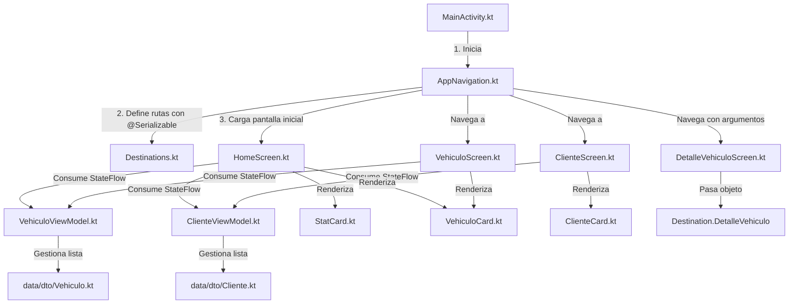

# 📚 Tutorial Detallado de Arquitectura y Flujo de Ejecución - AutoRent

Este documento detalla paso a paso la arquitectura, el código implementado y el flujo completo de la aplicación **AutoRent**.

---

## 🏗️ 1. Estructura Completa del Proyecto

```text
app/src/main/java/com/example/proyectointegrador/
│
├── data/                                <-- CAPA DE DATOS
│    ├── network/                        (.gitkeep - Preparado para Retrofit)
│    ├── api/                            (.gitkeep - Preparado para Endpoints API)
│    ├── dto/                            (Data Transfer Objects / Modelos)
│    │    ├── Vehiculo.kt
│    │    └── Cliente.kt
│    └── repository/                     (.gitkeep - Preparado para Repositorios)
│
├── presentation/                        <-- CAPA DE PRESENTACIÓN
│    ├── viewmodel/                      (Gestión de Estado con StateFlow)
│    │    ├── VehiculoViewModel.kt
│    │    └── ClienteViewModel.kt
│    ├── navigation/                     (Navegación Type-Safe oficial con @Serializable)
│    │    ├── Destinations.kt
│    │    └── AppNavigation.kt
│    ├── screens/                        (Pantallas Jetpack Compose)
│    │    ├── HomeScreen.kt
│    │    ├── VehiculoScreen.kt
│    │    ├── ClienteScreen.kt
│    │    └── DetalleVehiculoScreen.kt
│    └── components/                     (Componentes de UI Reutilizables)
│         ├── VehiculoCard.kt
│         ├── ClienteCard.kt
│         └── StatCard.kt
│
├── docs/                                <-- PAQUETE DE DOCUMENTACIÓN DEL PROYECTO
│    └── tutorial_arquitectura.md
│
├── ui/                                  <-- TEMA DE LA APLICACIÓN (MATERIAL 3)
│    └── theme/
│         ├── Color.kt
│         ├── Theme.kt
│         └── Type.kt
│
└── MainActivity.kt                      <-- PUNTO DE ENTRADA PRINCIPAL
```

---

## 🔄 2. Diagrama del Flujo de Datos y Conexión de Archivos



---

## 📂 3. Análisis de Código Archivo por Archivo e Interconexión

### 3.1. Capa de Datos (`data/dto/`)

#### 📄 `data/dto/Vehiculo.kt`
Representa el modelo de datos de un vehículo en el sistema:
```kotlin
package com.example.proyectointegrador.data.dto

data class Vehiculo(
    val id: String,
    val marca: String,
    val modelo: String,
    val precioPorDia: Double,
    val disponible: Boolean = true
)
```

#### 📄 `data/dto/Cliente.kt`
Representa el modelo de datos de un cliente:
```kotlin
package com.example.proyectointegrador.data.dto

data class Cliente(
    val id: String,
    val nombre: String,
    val documento: String,
    val telefono: String
)
```

---

### 3.2. Capa de Presentación: ViewModels (`presentation/viewmodel/`)

Los ViewModels encapsulan la lógica de negocio y exponen datos reactivos mediante `StateFlow`:

#### 📄 `presentation/viewmodel/VehiculoViewModel.kt`
```kotlin
package com.example.proyectointegrador.presentation.viewmodel

import androidx.lifecycle.ViewModel
import com.example.proyectointegrador.data.dto.Vehiculo
import kotlinx.coroutines.flow.MutableStateFlow
import kotlinx.coroutines.flow.StateFlow
import kotlinx.coroutines.flow.asStateFlow
import java.util.UUID

class VehiculoViewModel : ViewModel() {

    private val _vehiculos = MutableStateFlow<List<Vehiculo>>(
        listOf(
            Vehiculo(UUID.randomUUID().toString(), "Toyota", "Corolla 2024", 45.0),
            Vehiculo(UUID.randomUUID().toString(), "Ford", "Mustang GT", 95.0),
            Vehiculo(UUID.randomUUID().toString(), "Chevrolet", "Tracker SUV", 60.0)
        )
    )
    val vehiculos: StateFlow<List<Vehiculo>> = _vehiculos.asStateFlow()

    fun agregarVehiculo(marca: String, modelo: String, precioPorDia: Double) {
        val nuevoVehiculo = Vehiculo(
            id = UUID.randomUUID().toString(),
            marca = marca,
            modelo = modelo,
            precioPorDia = precioPorDia
        )
        _vehiculos.value = _vehiculos.value + nuevoVehiculo
    }

    fun eliminarVehiculo(id: String) {
        _vehiculos.value = _vehiculos.value.filter { it.id != id }
    }
}
```

---

### 3.3. Capa de Presentación: Componentes Reutilizables (`presentation/components/`)

#### 📄 `presentation/components/VehiculoCard.kt`
Componente reutilizable que renderiza la información del vehículo y gestiona acciones de clic en las pantallas `HomeScreen` y `VehiculoScreen`:
```kotlin
package com.example.proyectointegrador.presentation.components

import androidx.compose.foundation.layout.*
import androidx.compose.material.icons.Icons
import androidx.compose.material.icons.filled.Delete
import androidx.compose.material.icons.filled.Info
import androidx.compose.material3.*
import androidx.compose.runtime.Composable
import androidx.compose.ui.Alignment
import androidx.compose.ui.Modifier
import androidx.compose.ui.text.font.FontWeight
import androidx.compose.ui.unit.dp
import androidx.compose.ui.unit.sp
import com.example.proyectointegrador.data.dto.Vehiculo

@Composable
fun VehiculoCard(
    vehiculo: Vehiculo,
    modifier: Modifier = Modifier,
    onVerDetalle: (() -> Unit)? = null,
    onDelete: (() -> Unit)? = null
) {
    Card(
        modifier = modifier
            .fillMaxWidth()
            .padding(vertical = 4.dp),
        elevation = CardDefaults.cardElevation(defaultElevation = 2.dp)
    ) {
        Row(
            modifier = Modifier
                .fillMaxWidth()
                .padding(16.dp),
            verticalAlignment = Alignment.CenterVertically,
            horizontalArrangement = Arrangement.SpaceBetween
        ) {
            Column(modifier = Modifier.weight(1f)) {
                Text(
                    text = "${vehiculo.marca} ${vehiculo.modelo}",
                    fontWeight = FontWeight.Bold,
                    fontSize = 18.sp
                )
                Spacer(modifier = Modifier.height(2.dp))
                Text(
                    text = "Tarifa: $${vehiculo.precioPorDia} / día",
                    fontSize = 14.sp,
                    color = MaterialTheme.colorScheme.onSurfaceVariant
                )
            }
            Row {
                onVerDetalle?.let { onClick ->
                    IconButton(onClick = onClick) {
                        Icon(
                            imageVector = Icons.Default.Info,
                            contentDescription = "Ver Detalle",
                            tint = MaterialTheme.colorScheme.primary
                        )
                    }
                }
                onDelete?.let { onClick ->
                    IconButton(onClick = onClick) {
                        Icon(
                            imageVector = Icons.Default.Delete,
                            contentDescription = "Eliminar vehículo",
                            tint = MaterialTheme.colorScheme.error
                        )
                    }
                }
            }
        }
    }
}
```

---

### 3.4. Capa de Presentación: Navegación (`presentation/navigation/`)

#### 📄 `presentation/navigation/Destinations.kt`
Define las rutas tipo-segura en formato Type-Safe recomendadas por Google con `kotlinx.serialization`:
```kotlin
package com.example.proyectointegrador.presentation.navigation

import kotlinx.serialization.Serializable

sealed interface Destination {
    @Serializable
    data object Home : Destination

    @Serializable
    data object Vehiculos : Destination

    @Serializable
    data object Clientes : Destination

    @Serializable
    data class DetalleVehiculo(
        val id: String,
        val marca: String,
        val modelo: String,
        val precioPorDia: Double
    ) : Destination
}
```

#### 📄 `presentation/navigation/AppNavigation.kt`
Configura el `NavHost` conectando las 4 pantallas:
```kotlin
package com.example.proyectointegrador.presentation.navigation

import androidx.compose.runtime.Composable
import androidx.lifecycle.viewmodel.compose.viewModel
import androidx.navigation.NavHostController
import androidx.navigation.compose.NavHost
import androidx.navigation.compose.composable
import androidx.navigation.compose.rememberNavController
import androidx.navigation.toRoute
import com.example.proyectointegrador.presentation.screens.ClienteScreen
import com.example.proyectointegrador.presentation.screens.DetalleVehiculoScreen
import com.example.proyectointegrador.presentation.screens.HomeScreen
import com.example.proyectointegrador.presentation.screens.VehiculoScreen
import com.example.proyectointegrador.presentation.viewmodel.ClienteViewModel
import com.example.proyectointegrador.presentation.viewmodel.VehiculoViewModel

@Composable
fun AppNavigation(
    navController: NavHostController = rememberNavController(),
    vehiculoViewModel: VehiculoViewModel = viewModel(),
    clienteViewModel: ClienteViewModel = viewModel()
) {
    NavHost(
        navController = navController,
        startDestination = Destination.Home
    ) {
        // Pantalla 1: Home
        composable<Destination.Home> {
            HomeScreen(
                vehiculoViewModel = vehiculoViewModel,
                clienteViewModel = clienteViewModel,
                onNavigateToVehiculos = { navController.navigate(Destination.Vehiculos) },
                onNavigateToClientes = { navController.navigate(Destination.Clientes) },
                onNavigateToDetalle = { vehiculo ->
                    navController.navigate(
                        Destination.DetalleVehiculo(
                            id = vehiculo.id,
                            marca = vehiculo.marca,
                            modelo = vehiculo.modelo,
                            precioPorDia = vehiculo.precioPorDia
                        )
                    )
                }
            )
        }

        // Pantalla 2: Vehículos
        composable<Destination.Vehiculos> {
            VehiculoScreen(
                viewModel = vehiculoViewModel,
                onNavigateBack = { navController.popBackStack() },
                onVerDetalle = { vehiculo ->
                    navController.navigate(
                        Destination.DetalleVehiculo(
                            id = vehiculo.id,
                            marca = vehiculo.marca,
                            modelo = vehiculo.modelo,
                            precioPorDia = vehiculo.precioPorDia
                        )
                    )
                }
            )
        }

        // Pantalla 3: Clientes
        composable<Destination.Clientes> {
            ClienteScreen(
                viewModel = clienteViewModel,
                onNavigateBack = { navController.popBackStack() }
            )
        }

        // Pantalla 4: Detalle de Vehículo (Argumentos Type-Safe)
        composable<Destination.DetalleVehiculo> { backStackEntry ->
            val destination: Destination.DetalleVehiculo = backStackEntry.toRoute()
            DetalleVehiculoScreen(
                id = destination.id,
                marca = destination.marca,
                modelo = destination.modelo,
                precioPorDia = destination.precioPorDia,
                onNavigateBack = { navController.popBackStack() }
            )
        }
    }
}
```

---

### 3.5. Punto de Entrada (`MainActivity.kt`)

```kotlin
package com.example.proyectointegrador

import android.os.Bundle
import androidx.activity.ComponentActivity
import androidx.activity.compose.setContent
import androidx.activity.enableEdgeToEdge
import androidx.compose.foundation.layout.fillMaxSize
import androidx.compose.material3.MaterialTheme
import androidx.compose.material3.Surface
import androidx.compose.ui.Modifier
import com.example.proyectointegrador.presentation.navigation.AppNavigation
import com.example.proyectointegrador.ui.theme.ProyectoIntegradorTheme

class MainActivity : ComponentActivity() {
    override fun onCreate(savedInstanceState: Bundle?) {
        super.onCreate(savedInstanceState)
        enableEdgeToEdge()
        setContent {
            ProyectoIntegradorTheme {
                Surface(
                    modifier = Modifier.fillMaxSize(),
                    color = MaterialTheme.colorScheme.background
                ) {
                    AppNavigation()
                }
            }
        }
    }
}
```

---

## ⚡ 4. Caso Práctico de Flujo Completo

### Ejemplo: Registrar un nuevo vehículo y navegar a su detalle

1. **Apertura**: `MainActivity` carga `AppNavigation()` y muestra la pantalla inicial `HomeScreen`.
2. **Navegación a Catálogo**:
   - El usuario presiona el botón **"Gestionar Vehículos"** en `HomeScreen`.
   - Se ejecuta el callback `onNavigateToVehiculos` -> `navController.navigate(Destination.Vehiculos)`.
   - Se renderiza `VehiculoScreen`.
3. **Registro de un Vehículo**:
   - El usuario ingresa la marca, el modelo y el precio por día.
   - Presiona el botón **"Agregar Vehículo"**.
   - Se llama a `viewModel.agregarVehiculo(marca, modelo, precio)`.
   - `VehiculoViewModel` emite una nueva lista a través del `_vehiculos StateFlow`.
   - `VehiculoScreen` observa los cambios mediante `val vehiculos by viewModel.vehiculos.collectAsState()` y vuelve a dibujar la lista utilizando el componente `VehiculoCard`.
4. **Navegación al Detalle (Type-Safe)**:
   - El usuario toca el icono de información `Icons.Default.Info` en un `VehiculoCard`.
   - Se llama a `onVerDetalle(vehiculo)`.
   - `AppNavigation` ejecuta `navController.navigate(Destination.DetalleVehiculo(id, marca, modelo, precioPorDia))`.
   - `AppNavigation` extrae los argumentos fuertemente tipados con `backStackEntry.toRoute<Destination.DetalleVehiculo>()` y los pasa a `DetalleVehiculoScreen`.
5. **Visualización**: `DetalleVehiculoScreen` recibe los argumentos y calcula automáticamente estimaciones de costos por 3 y 7 días.

---

## 🎯 Conclusión

La arquitectura implementada respeta los principios sólidos del desarrollo Android moderno:
- **Modularidad y Limpieza**: Separación estricta entre capa de datos (`data`), vista/control (`presentation`), documentación (`docs`) y diseño (`ui`).
- **Navegación Type-Safe**: Prevención de errores en tiempo de compilación al evitar concatenación manual de rutas string (`/detalle/{id}`).
- **Componentes Reutilizables**: Reducción de código duplicado a través de compasables modulares en `presentation/components/`.
- **Estado Reactivo**: Uso de Kotlin `StateFlow` y Jetpack Compose State para mantener la UI sincronizada de forma automática.
